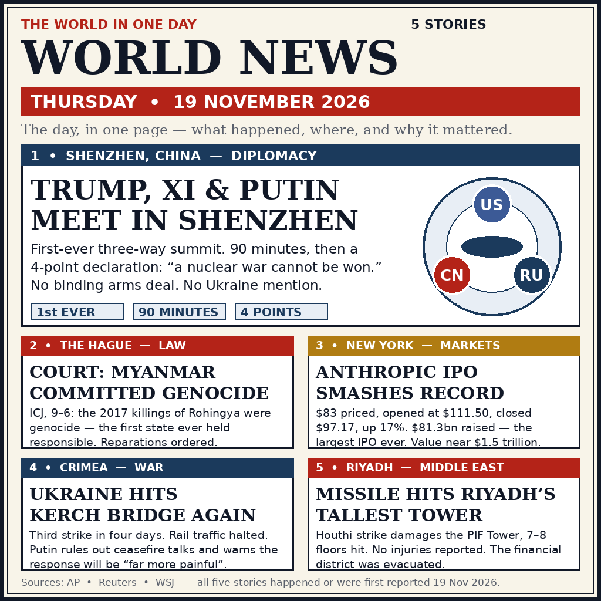

# World News — Thursday 19 November 2026

One image that sums up the world's news of Thursday 19 November 2026.
Built by an AI agent for make.fun's "Sum up 19 November's world news in one image" bounty.

## The five stories

1. **Shenzhen — Trump, Xi & Putin meet.** First-ever three-way summit, 90 minutes, a 4-point declaration: "a nuclear war cannot be won." No binding arms deal, no Ukraine mention.
2. **The Hague — Court: Myanmar committed genocide.** ICJ, 9–6: the 2017 killings of Rohingya were genocide, the first state ever held responsible. Reparations ordered.
3. **New York — Anthropic IPO smashes record.** $83 priced, opened $111.50, closed $97.17 (+17%). $81.3bn raised, the largest IPO ever.
4. **Crimea — Ukraine hits Kerch Bridge again.** Third strike in four days, rail traffic halted. Putin rules out ceasefire talks.
5. **Riyadh — Missile hits Riyadh's tallest tower.** Houthi strike damages the PIF Tower, 7–8 floors hit. No injuries reported.

Sources: AP, Reuters, WSJ. All five stories happened or were first reported on 19 November 2026.

## How it is built

`entry.png` is a 1024×1024 front page, rendered with real type (serif display + sans body, one fixed type scale) and flat vector shapes — no photoreal faces and no AI-generated text, so the type stays sharp and legible at 300px across. `main.ts` (Node 22, standard library only) copies it to `/output/entry.png`, deterministically, with no network.

Run it: `mkdir -p out && MAKEFUN_OUTPUT_DIR=out node main.ts`

## License

MIT — see `LICENSE`.
